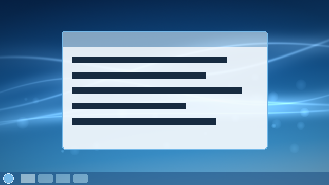

# Omarchy Aero7

给 [Omarchy](https://omarchy.org) 用的蓝色玻璃主题，风格参考 Windows 7 的 Aero：半透明蓝灰玻璃任务栏放在底部，窗口有白色到天蓝的渐变边框、圆角和柔和阴影，菜单和通知是浅色磨砂玻璃，配两张原创的蓝色光带壁纸。

只改外观，不改系统行为：快捷键、窗口管理、工作区、软件、显卡和显示器设置都不动。



> 本项目与微软没有关系。“Windows 7”和“Aero”只用来说明风格参考，项目里没有任何微软的图片、图标、字体或代码，壁纸和配色都是原创。

## 安装

在 Omarchy 里按 `SUPER + Enter` 打开终端，粘贴这一行：

```bash
curl -fsSL https://raw.githubusercontent.com/Freecode100Year/omarchy-aero7/main/scripts/install.sh | bash
```

连不上 GitHub 时用 GitLab：

```bash
curl -fsSL https://gitlab.com/sj9292008133/omarchy-aero7/-/raw/main/scripts/install.sh | bash
```

安装时会列出要改的地方，按回车确认。它不需要 `sudo`，先备份你现在的主题、任务栏和文字大小。

## 常用命令

| 命令 | 作用 |
|---|---|
| `aero7 level full` | 完整玻璃：模糊 + 半透明 + 阴影（默认） |
| `aero7 level light` | 轻玻璃：模糊减半、更不透明、阴影变小，显卡吃力时用 |
| `aero7 level solid` | 不透明：关掉模糊和透明，只保留蓝色配色，最省电 |
| `aero7 scale 125` | 界面文字缩放：`100` `125` `150` `175` `200`，`keep` 表示不改 |
| `aero7 edit` | 打开设置文件 |
| `aero7 apply` | 改完设置文件后生效 |
| `aero7 status` | 看现在的设置 |
| `aero7 restore` | 恢复安装前的样子（主题、任务栏、文字大小、壁纸） |
| `~/.local/share/omarchy-aero7/scripts/uninstall.sh` | 完全卸载 |

## 设置文件

`~/.config/omarchy-aero7/aero7.toml`：

```toml
[theme]
variant = "aero-blue"     # aero-blue 蓝天 / aero-dusk 暮色

[effects]
level = "full"            # full / light / solid

[glass]
opacity = 0.86            # 终端等半透明窗口的不透明度 0.6–1.0
blur = true
blur_strength = 8         # 1–20

[window]
corner_radius = 7
border_size = 2
shadow = true

[taskbar]
position = "bottom"       # bottom / top / left / right
glass = true

[typography]
scale = "keep"            # keep / 1.0 / 1.25 / 1.5 / 1.75 / 2.0
```

Hyprland 和 Omarchy 不直接读这个文件，是 `aero7 apply` 把它转换成它们的设置。

## 做了什么、没做什么

做到的：Aero 蓝配色，底部玻璃任务栏，浅色磨砂玻璃的开始菜单、启动器和通知，蓝色渐变窗口边框，7 像素圆角，阴影，背景模糊，终端半透明，三档效果，界面缩放，两张 4K 原创壁纸（另附 1080p 和 1440p，在 `wallpapers/`），安装、备份、恢复、卸载。

做不到或暂不做的，原因见 [docs/LIMITATIONS.md](docs/LIMITATIONS.md)：圆形开始按钮和 Windows 7 任务栏布局、每个窗口的 Windows 7 标题栏和按钮、Windows 7 图标和鼠标指针、GTK 应用整体换皮、登录界面。

## 文档

- [安装和卸载](docs/INSTALL.md)
- [兼容性](docs/COMPATIBILITY.md)
- [限制](docs/LIMITATIONS.md)

## 开发

```bash
python3 tools/make_wallpapers.py              # 画壁纸（需要 python3-numpy、python3-pil）
python3 tools/build_theme.py ~/omarchy-源码    # 生成 colors.toml / shell.toml / 预览图并检查对比度
bash tests/cli_test.sh                        # 在模拟的 Omarchy 环境里测试安装、各档效果、恢复和卸载
```

`shell.toml` 由 Omarchy 自己的模板生成，再写入 Aero 的玻璃参数，所以 Omarchy 加了新设置项也不会漏。

MIT 许可证。
